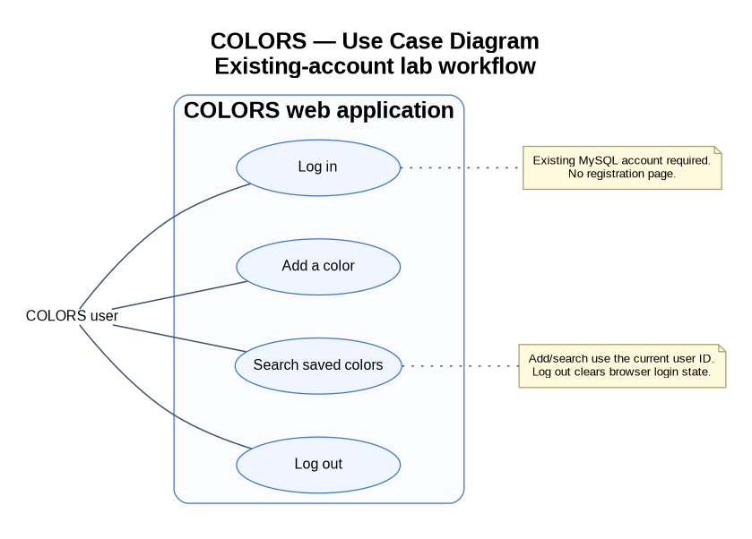
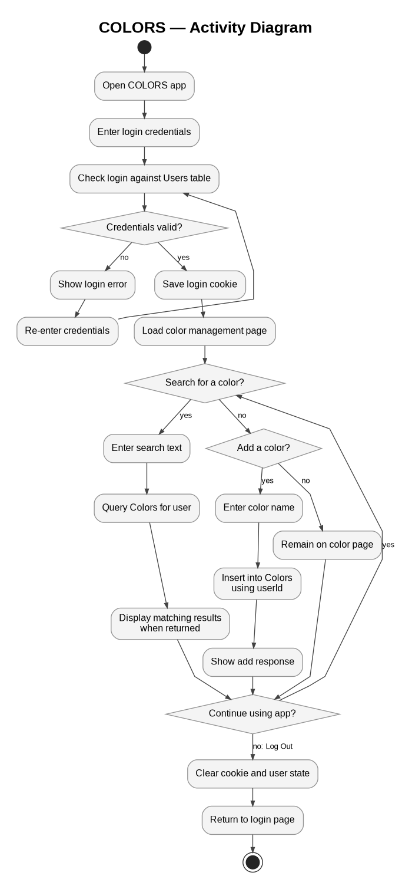
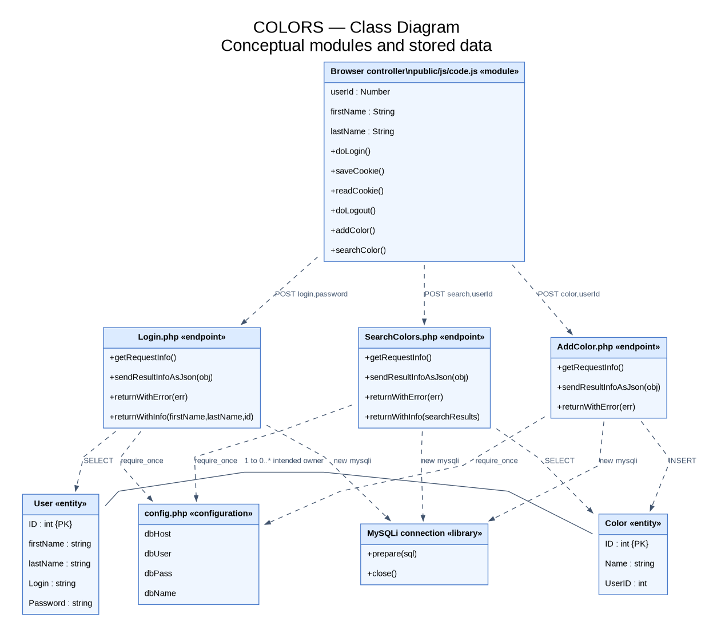

# COLORS UML Diagrams

These diagrams represent my COLORS LAMP web application for COP 4331C. The application allows users to log in, add colors, search their saved colors, and log out.

## 1. Use Case Diagram

Shows the main actions a user can perform in the COLORS application.

[View PlantUML Source](usecase.puml)

## 2. Activity Diagram

Shows the workflow from logging in to adding or searching colors and logging out.

[View PlantUML Source](activity.puml)

## 3. Class Diagram

Shows the JavaScript controller, PHP endpoints, database connections, and User and Color entities. The application uses procedural modules rather than actual object-oriented classes.

[View PlantUML Source](class.puml)

## Implementation Notes

- Frontend: HTML, CSS, and JavaScript.
- Backend: PHP endpoints for login, adding colors, and searching colors.
- Database: MySQL Users and Colors tables.
- Database configuration: api/config.php.
- No user registration functionality.

The diagrams represent the main functionality of the implemented COLORS application.
  
